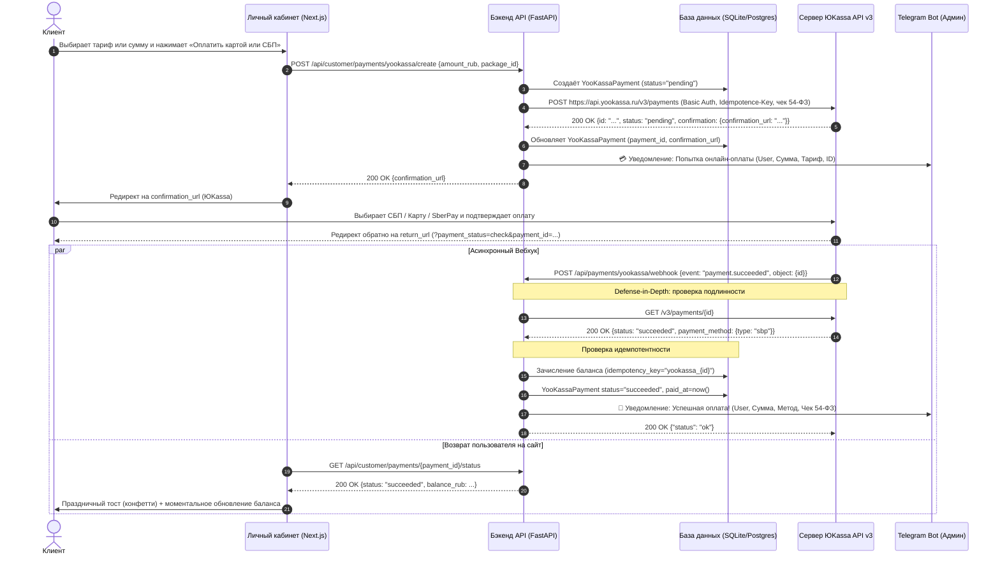

# YooKassa v3 Payment Integration Blueprint & Implementation Guide

Этот документ — эталонная архитектура и руководство по подключению приёма онлайн-платежей через **ЮKassa API v3** (Банковские карты, СБП, SberPay, Mir Pay, T-Pay, ЮMoney) с фискализацией 54-ФЗ и Telegram-уведомлениями. 

Архитектура отработана, протестирована и развёрнута в продакшене платформы **TenderLex**. Любой AI-агент или разработчик может использовать этот документ для быстрого и безопасного переноса функционала в другие проекты (на Python, TypeScript/Node.js, Telegram-боты, SaaS).

---

## 1. Карта файлов реализации в TenderLex

Для изучения живого рабочего кода используйте следующие файлы:

| Компонент | Путь к файлу | Назначение |
|-----------|--------------|------------|
| **API-клиент ЮKassa** | [`backend/app/yookassa_service.py`](file:///root/projects/tenderlex/backend/app/yookassa_service.py) | Взаимодействие с API ЮKassa v3, генерация чеков 54-ФЗ, валидация ключей, отправка Telegram-уведомлений |
| **API-эндпоинты** | [`backend/app/main.py`](file:///root/projects/tenderlex/backend/app/main.py#L1920-L2150) | Создание платежа (`/create`), опрос статуса (`/status`), вебхук (`/webhook`), тест подключения (`/test`) |
| **Модели БД** | [`backend/app/models.py`](file:///root/projects/tenderlex/backend/app/models.py#L520-L555) | Модель `YooKassaPayment`, поля в `SystemSettings` |
| **Схемы Pydantic** | [`backend/app/schemas.py`](file:///root/projects/tenderlex/backend/app/schemas.py#L65-L75) | Валидация входных данных `CreateYooKassaPaymentRequest`, `YooKassaTestRequest` |
| **Миграции БД** | [`backend/app/db.py`](file:///root/projects/tenderlex/backend/app/db.py#L620-L660) | Автоматическое создание таблицы `yookassa_payments` и колонок |
| **Клиентский чекаут** | [`site/src/app/cabinet/cabinet-client.tsx`](file:///root/projects/tenderlex/site/src/app/cabinet/cabinet-client.tsx) | Единая форма пополнения (Карта, СБП), тарифы, бонусы, редирект, автопроверка возврата и конфетти |
| **Админ-панель** | [`frontend/src/App.tsx`](file:///root/projects/tenderlex/frontend/src/App.tsx#L5860-L5920) | Настройка Shop ID, Secret Key, 54-ФЗ и кнопка проверки подключения без предварительного сохранения |
| **Автотесты** | [`backend/tests/test_yookassa_payments.py`](file:///root/projects/tenderlex/backend/tests/test_yookassa_payments.py) | 5 комплексных тестов (клиент, API, вебхук, идемпотентность, Telegram-уведомления) |

---

## 2. Архитектура и Data Flow



---

## 3. Критические правила безопасности и надёжности (Iron Rules)

### 1. Никогда не доверяйте телу вебхука вслепую (Defense-in-Depth)
Любой злоумышленник, узнав URL вебхука, может отправить поддельный JSON:
`{"event": "payment.succeeded", "object": {"id": "fake", "amount": {"value": "100000.00"}}}`.
**Решение:**
При получении вебхука бэкенд берёт только `payment_id` и делает **прямой защищённый запрос** к API ЮKassa:
```python
verified = fetch_yookassa_payment(shop_id=settings.yookassa_shop_id, secret_key=settings.yookassa_secret_key, payment_id=payment_id)
if not verified or verified.get("status") != "succeeded":
    return {"status": "unverified"}
```
Баланс начисляется **только** на основе данных, полученных напрямую из официального API ЮKassa!

### 2. Строгая идемпотентность начислений (Zero Double-Spend)
ЮKassa может присылать повторные вебхуки (retry при задержке ответа, сетевые флапы). Также клиент может параллельно дёргать эндпоинт `/status`.
**Решение:**
Все транзакции зачисления маркируются уникальным ключом:
```python
idempotency_key = f"yookassa_{payment_id}"
existing_tx = db.query(BillingTransaction).filter(BillingTransaction.idempotency_key == idempotency_key).first()
if not existing_tx:
    grant_money_balance(..., idempotency_key=idempotency_key)
```
Повторные вызовы никогда не приведут к повторному зачислению денег.

### 3. Заголовок `Idempotence-Key` при создании платежей в ЮKassa
При обращении к `POST /v3/payments` обязательно передавать заголовок `Idempotence-Key: <uuid>`. В случае обрыва связи и повторной отправки запроса ЮKassa не создаст второй платёж, а вернёт существующий.

### 4. Никаких секретных ключей на фронтенде и в Git
- `yookassa_secret_key` хранится исключительно в БД бэкенда или защищённом `.env`.
- В админ-панели при редактировании секретный ключ маскируется (`••••••••`) и передаётся только при изменении.
- Никогда не коммитить реальные боевые ключи (`live_...`) в Git.

---

## 4. Настройка кабинета ЮKassa (Инструкция)

1. Зайти в [Личный кабинет ЮKassa](https://yookassa.ru/).
2. В верхнем левом углу скопировать **Shop ID** (число, например `1509607`).
3. Перейти в раздел **Интеграция** → **Ключи API**:
   - Нажать **Выпустить секретный ключ**.
   - Скопировать ключ вида `live_...` (он показывается только один раз!).
4. Перейти в раздел **Интеграция** → **HTTP-уведомления (Вебхуки)**:
   - В поле **URL для уведомлений** указать:  
     `https://<ваш-домен>/api/payments/yookassa/webhook`
   - Отметить события:
     * `payment.succeeded` (Успешная оплата)
     * `payment.canceled` (Отмена оплаты)
   - Нажать **Сохранить**.
5. Проверить статус фискализации 54-ФЗ:
   - Если подключена услуга «Чеки от ЮKassa» (или облачная касса), запросы к API с параметром `receipt` будут автоматически регистрировать чеки в ФНС и отправлять их клиенту по email.

---

## 5. Готовый код реализации (Python / FastAPI)

### 5.1. Сервис работы с API ЮKassa (`yookassa_service.py`)

```python
import base64
import logging
import uuid
from typing import Any
import httpx

logger = logging.getLogger("payments.yookassa")
YOOKASSA_API_BASE = "https://api.yookassa.ru/v3"

def create_yookassa_payment(
    *,
    shop_id: str,
    secret_key: str,
    amount_rub: int,
    return_url: str,
    description: str,
    metadata: dict[str, Any] | None = None,
    customer_email: str | None = None,
    send_receipt: bool = False,
    timeout_seconds: float = 20.0,
) -> dict[str, Any]:
    """Создание платежной сессии в ЮKassa v3."""
    safe_amount = max(1, int(amount_rub))
    clean_desc = str(description or "Пополнение баланса")[:128]
    safe_metadata = {str(k): str(v) for k, v in (metadata or {}).items()}

    def _build_payload(with_receipt: bool) -> dict[str, Any]:
        body: dict[str, Any] = {
            "amount": {"value": f"{safe_amount:.2f}", "currency": "RUB"},
            "capture": True,
            "confirmation": {"type": "redirect", "return_url": return_url},
            "description": clean_desc,
            "metadata": safe_metadata,
        }
        if with_receipt and customer_email and "@" in customer_email:
            body["receipt"] = {
                "customer": {"email": customer_email.strip().lower()},
                "items": [
                    {
                        "description": clean_desc[:128],
                        "quantity": "1.00",
                        "amount": {"value": f"{safe_amount:.2f}", "currency": "RUB"},
                        "vat_code": 1,  # 1 = без НДС (для УСН/патента). При ОСНО укажите 4 (НДС 20%)
                        "payment_subject": "service",
                        "payment_mode": "full_payment",
                    }
                ],
            }
        return body

    url = f"{YOOKASSA_API_BASE}/payments"
    auth = httpx.BasicAuth(shop_id.strip(), secret_key.strip())
    idem_key = str(uuid.uuid4())

    with httpx.Client(timeout=timeout_seconds) as client:
        # Попытка №1 (с чеком 54-ФЗ, если запрошено)
        payload = _build_payload(with_receipt=send_receipt)
        resp = client.post(url, json=payload, auth=auth, headers={"Idempotence-Key": idem_key})
        
        # Если касса не подключена в кабинете ЮKassa, повторить без чека
        if resp.status_code == 400 and send_receipt and "receipt" in resp.text:
            logger.warning("YooKassa rejected receipt, retrying without receipt: %s", resp.text)
            idem_key = str(uuid.uuid4())
            payload = _build_payload(with_receipt=False)
            resp = client.post(url, json=payload, auth=auth, headers={"Idempotence-Key": idem_key})

        if resp.status_code not in (200, 201):
            raise RuntimeError(f"Ошибка ЮKassa ({resp.status_code}): {resp.text}")

        return resp.json()


def fetch_yookassa_payment(
    *,
    shop_id: str,
    secret_key: str,
    payment_id: str,
    timeout_seconds: float = 15.0,
) -> dict[str, Any] | None:
    """Прямой запрос статуса платежа из API ЮKassa для верификации."""
    url = f"{YOOKASSA_API_BASE}/payments/{payment_id.strip()}"
    auth = httpx.BasicAuth(shop_id.strip(), secret_key.strip())
    with httpx.Client(timeout=timeout_seconds) as client:
        resp = client.get(url, auth=auth)
        if resp.status_code == 200:
            return resp.json()
        return None


def verify_yookassa_credentials(*, shop_id: str, secret_key: str) -> tuple[bool, str]:
    """Быстрая проверка валидности Shop ID и Secret Key через /me."""
    url = f"{YOOKASSA_API_BASE}/me"
    auth = httpx.BasicAuth(shop_id.strip(), secret_key.strip())
    with httpx.Client(timeout=10.0) as client:
        try:
            resp = client.get(url, auth=auth)
            if resp.status_code == 200:
                return True, "Подключение к ЮKassa успешно проверено"
            if resp.status_code in (401, 403):
                return False, "Неверный Shop ID или Секретный ключ ЮKassa"
            return False, f"ЮKassa вернула статус {resp.status_code}"
        except Exception as exc:
            return False, f"Ошибка сети: {exc}"
```

### 5.2. Модель БД (SQLAlchemy)

```python
class YooKassaPayment(Base):
    __tablename__ = "yookassa_payments"

    id = Column(String(36), primary_key=True, default=lambda: str(uuid.uuid4()))
    payment_id = Column(String(64), unique=True, index=True, nullable=False)
    client_id = Column(String(36), ForeignKey("clients.id"), nullable=False, index=True)
    user_id = Column(String(36), nullable=True)
    status = Column(String(32), default="pending", index=True)  # pending, succeeded, canceled
    amount_rub = Column(Integer, nullable=False)
    bonus_rub = Column(Integer, default=0)
    total_credit_rub = Column(Integer, nullable=False)
    package_name = Column(String(128), default="Пополнение баланса")
    payment_method_type = Column(String(64), default="")  # bank_card, sbp, sber_pay
    confirmation_url = Column(Text, default="")
    created_at = Column(DateTime, default=datetime.utcnow)
    paid_at = Column(DateTime, nullable=True)
```

### 5.3. Эндпоинты FastAPI (`main.py`)

```python
@app.post("/api/customer/payments/yookassa/create")
def customer_create_payment(data: CreatePaymentRequest, user = Depends(get_current_user), db: Session = Depends(get_db)):
    settings = get_settings(db)
    
    amount_rub = int(data.amount_rub)
    bonus_rub = calculate_bonus(amount_rub)
    total_credit = amount_rub + bonus_rub
    
    # 1. Создаем локальную запись
    record = YooKassaPayment(
        payment_id=f"temp_{uuid.uuid4().hex[:16]}",
        client_id=user.client_id,
        user_id=user.id,
        amount_rub=amount_rub,
        bonus_rub=bonus_rub,
        total_credit_rub=total_credit,
        package_name=data.package_name or "Пополнение баланса",
    )
    db.add(record)
    db.flush()
    
    return_url = f"https://ваш-домен.ru/cabinet?payment_status=check&payment_id={record.id}"
    
    # 2. Создаем сессию в ЮKassa
    res = create_yookassa_payment(
        shop_id=settings.yookassa_shop_id,
        secret_key=settings.yookassa_secret_key,
        amount_rub=amount_rub,
        return_url=return_url,
        description=f"Оплата: {record.package_name} ({user.email})",
        metadata={"payment_record_id": record.id, "client_id": user.client_id},
        customer_email=user.email,
        send_receipt=bool(settings.yookassa_send_receipt),
    )
    
    record.payment_id = res["id"]
    record.confirmation_url = res["confirmation"]["confirmation_url"]
    db.commit()
    
    # 3. Уведомление в Telegram (асинхронно)
    notify_admin_payment_attempt(payment_id=record.payment_id, amount_rub=amount_rub, user_email=user.email)
    
    return {"confirmation_url": record.confirmation_url, "payment_id": record.payment_id}


@app.post("/api/payments/yookassa/webhook")
async def yookassa_webhook(request: Request, db: Session = Depends(get_db)):
    body = await request.json()
    event_type = body.get("event")
    payment_obj = body.get("object") or {}
    payment_id = payment_obj.get("id")
    
    if not payment_id:
        return {"status": "ignored"}
        
    settings = get_settings(db)
    # ПРОВЕРКА ПОДЛИННОСТИ ЧЕРЕЗ API ЮKASSA
    verified = fetch_yookassa_payment(
        shop_id=settings.yookassa_shop_id,
        secret_key=settings.yookassa_secret_key,
        payment_id=payment_id
    )
    if not verified:
        return {"status": "unverified"}
        
    live_status = verified.get("status")
    if live_status == "succeeded":
        # ИДЕМПОТЕНТНОЕ ЗАЧИСЛЕНИЕ
        record = db.query(YooKassaPayment).filter(YooKassaPayment.payment_id == payment_id).first()
        idempotency_key = f"yookassa_{payment_id}"
        
        if not check_tx_exists(db, idempotency_key):
            credit_client_balance(db, record.client_id, record.total_credit_rub, idempotency_key=idempotency_key)
            record.status = "succeeded"
            record.paid_at = datetime.utcnow()
            record.payment_method_type = verified.get("payment_method", {}).get("type", "")
            db.commit()
            
            # Уведомление в Telegram
            notify_admin_payment_success(payment_id=payment_id, amount_rub=record.amount_rub, total_credit_rub=record.total_credit_rub)
            
    elif live_status == "canceled":
        record = db.query(YooKassaPayment).filter(YooKassaPayment.payment_id == payment_id).first()
        if record and record.status != "succeeded":
            record.status = "canceled"
            db.commit()
            notify_admin_payment_canceled(payment_id=payment_id, amount_rub=record.amount_rub)
            
    return {"status": "ok"}
```

---

## 6. Как перенести реализацию в другие проекты

### 6.1. Для проектов на TypeScript / Node.js (CallsMax, Romantic)

1. Вместо `httpx` использовать `fetch` или `axios`:
```typescript
const authHeader = 'Basic ' + Buffer.from(`${shopId}:${secretKey}`).toString('base64');

export async function createYooKassaPayment(params: {
  shopId: string;
  secretKey: string;
  amountRub: number;
  returnUrl: string;
  description: string;
  customerEmail?: string;
}) {
  const res = await fetch('https://api.yookassa.ru/v3/payments', {
    method: 'POST',
    headers: {
      'Authorization': authHeader,
      'Content-Type': 'application/json',
      'Idempotence-Key': crypto.randomUUID(),
    },
    body: JSON.stringify({
      amount: { value: params.amountRub.toFixed(2), currency: 'RUB' },
      capture: true,
      confirmation: { type: 'redirect', return_url: params.returnUrl },
      description: params.description,
      receipt: params.customerEmail ? {
        customer: { email: params.customerEmail },
        items: [{
          description: params.description,
          quantity: '1.00',
          amount: { value: params.amountRub.toFixed(2), currency: 'RUB' },
          vat_code: 1,
          payment_subject: 'service',
          payment_mode: 'full_payment'
        }]
      } : undefined
    })
  });
  return await res.json();
}
```

2. В Express/NestJS контроллере реализовать аналогичные маршруты `/create`, `/status`, `/webhook`.

### 6.2. Для Telegram-ботов (без веб-кабинета)

Если пользователю нужно выставить оплату прямо в переписке Telegram:
1. Бот вызывает `createYooKassaPayment` с `return_url = "https://t.me/<имя_бота>"`.
2. Бот отправляет сообщение с инлайн-кнопкой URL:
   ```python
   keyboard = InlineKeyboardMarkup(inline_keyboard=[
       [InlineKeyboardButton(text=f"💳 Оплатить {amount} ₽ (Карта, СБП)", url=confirmation_url)]
   ])
   await message.answer("Перейдите по ссылке для безопасной оплаты через ЮKassa:", reply_markup=keyboard)
   ```
3. Когда ЮKassa пришлёт вебхук об успехе:
   - Бот начисляет доступ / подписку / баланс в БД.
   - Бот отправляет сообщение клиенту в Telegram: `🎉 Оплата прошла успешно! Ваш доступ активирован.`
   - Бот отправляет сообщение админу платформы.

---

## 7. Чек-лист проверки готовности перед запуском

- [x] В кабинете ЮKassa выпущен секретный ключ `live_...`.
- [x] В кабинете ЮKassa настроен вебхук на URL `https://<домен>/api/payments/yookassa/webhook` для событий `payment.succeeded` и `payment.canceled`.
- [x] В таблице настроек бэкенда заданы `payment_provider = 'yookassa'`, `yookassa_shop_id` и `yookassa_secret_key`.
- [x] Кнопка «Проверить подключение» в админке возвращает `True: Подключение к ЮKassa успешно проверено`.
- [x] При получении вебхука бэкенд проверяет платёж прямым запросом к `/v3/payments/{id}`.
- [x] Проверена защита от повторных списаний (идемпотентность по `idempotency_key`).
- [x] Админ получает уведомления в Telegram при попытке оплаты и при успешном зачислении.
- [x] В автотестах (`pytest` / `jest`) замоканы внешние вызовы ЮKassa и протестирован полный цикл.
